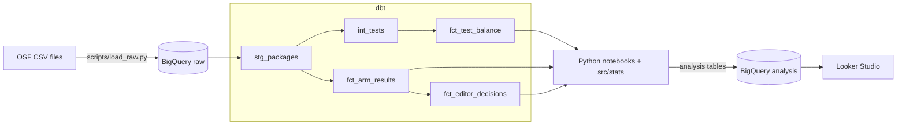

# Headline A/B Test Audit

> **Status: work in progress.** Analysis on the exploratory set is complete.
> Replication on the held-out confirmatory set, design decision records and a decision memo are in progress.

Auditing 32,000 headline A/B tests from Upworthy: can the randomization be trusted,
how much can a single test tell you, and were editors' winning picks backed by evidence?

**Running cost: $0** (BigQuery sandbox, dbt Core, Looker Studio)

## Key findings (exploratory set, 4,873 tests)

| Question | Finding |
|---|---|
| Q1. Can we trust the randomization? | A chi-square SRM check flags 70.0% of tests in the window the archive authors marked as unreliable, versus 0.47% outside it. 97.6% of flagged tests fall inside the window. |
| Q2. How much can one test tell you? | Even the largest reliable two-arm test (about 15,000 impressions per arm) could only detect differences of 20.6% or more. Detecting a 10% lift needs about 65,000 impressions per arm. |
| Q3. Were editors' picks backed by evidence? | 92.5% of 730 editor decisions were made when the data could not separate the chosen arm from the best alternative. Only 7.1% of picks were clearly better than the runner-up. |

## Architecture



| Layer | Tool | Why |
|---|---|---|
| Warehouse | BigQuery sandbox | Serverless SQL with no billing account |
| Modeling | dbt Core | Layered models, data tests, lineage |
| Statistics | Python (scipy, statsmodels) | Distribution functions BigQuery lacks; unit-testable |
| Visualization | Looker Studio | Free, reads BigQuery directly |
| Quality | pytest, ruff, GitHub Actions | Every push is linted and tested |

## Engineering practices

- **Raw data is never modified.** All columns load as STRING; types are cast in dbt staging,
  and a value that cannot be cast fails the build.
- **24 dbt data tests** guard assumptions in the SQL, such as one dataset split per test and
  one arm per CTR rank.
- **Statistical logic has one tested implementation.** `src/stats/` is shared by every
  notebook and covered by 15 unit tests, including checks against the Q2 results.
- **No credentials in the repository.** Authentication uses Application Default Credentials;
  CI runs without cloud access.

## Repository structure

```text
├── dbt/                  # dbt project: staging, intermediate, marts, data tests
├── docs/figures/         # Charts used in this README
├── notebooks/            # 01 explore, 02 Q1, 03 Q2, 04 Q3
├── scripts/load_raw.py   # Load CSVs into BigQuery
├── src/stats/            # Shared statistical functions
└── tests/                # pytest
```

## Data

Matias, J.N., Munger, K., Le Quere, M.A., & Ebersole, C. (2021).
The Upworthy Research Archive, a time series of 32,487 experiments in U.S. media.
*Scientific Data*, 8, 195. Licensed under CC BY 4.0.
Raw data is not redistributed in this repository.