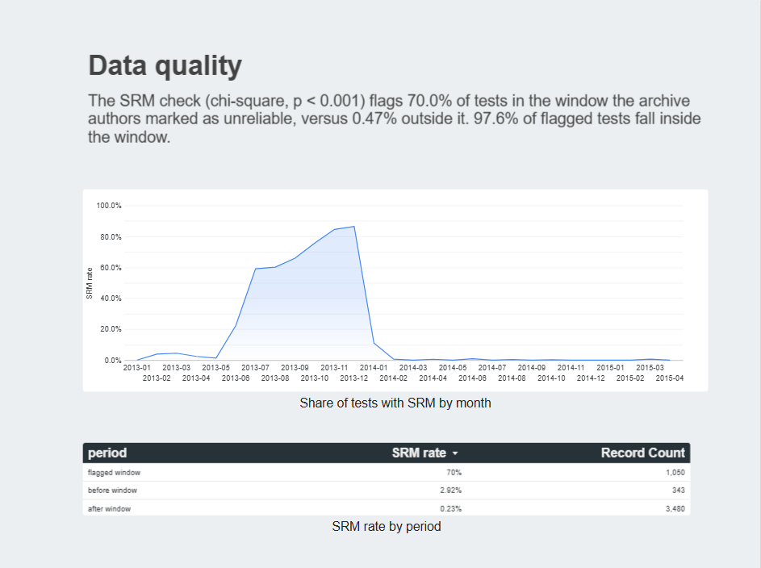
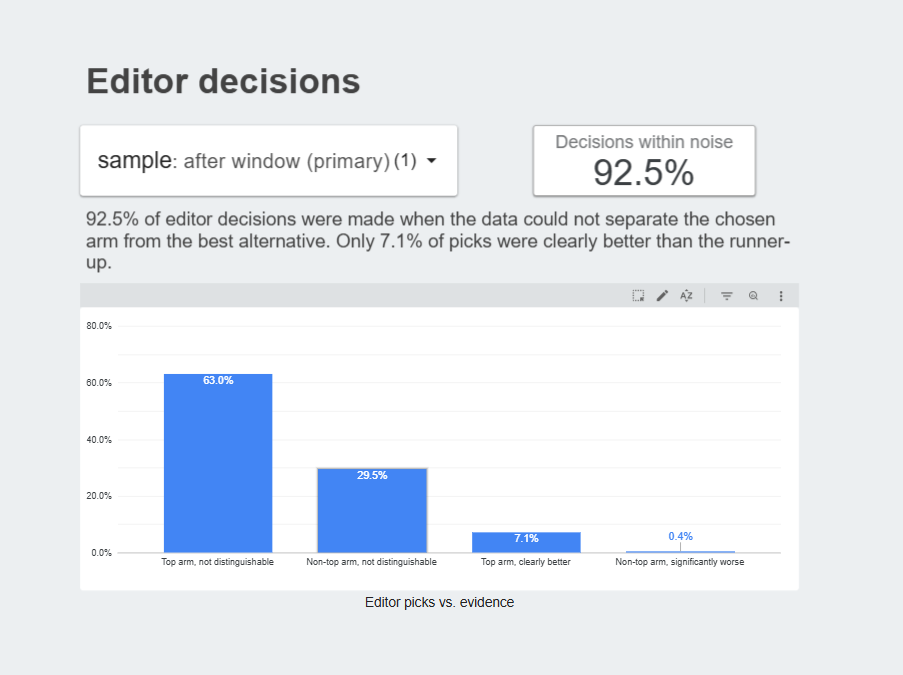
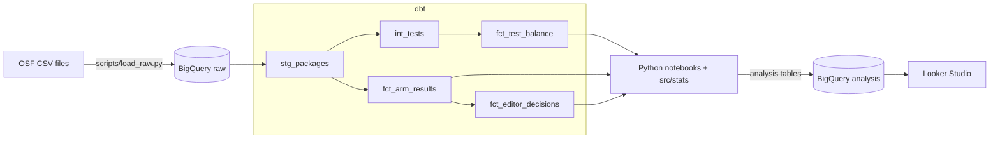

# Headline A/B Test Audit

Auditing about 27,600 headline A/B tests from the Upworthy Research Archive:
can the randomization be trusted, how much can a single test tell you,
and were editors' winning picks backed by evidence?

**Running cost: $0** · BigQuery sandbox · dbt Core · Python · Looker Studio


## Key findings

| Question | Finding |
|---|---|
| **Q1.** Can we trust the randomization? | A chi-square sample ratio mismatch (SRM) check flags **70%** of tests in the window the archive authors marked as unreliable, versus **0.5%** outside it. **97%** of flagged tests fall inside the window. |
| **Q2.** How much can one test tell you? | The largest reliable two-arm test (about 15,000 impressions per arm) could only detect CTR differences of **20.6%** or more. Detecting a 10% lift needs about **65,000** impressions per arm. |
| **Q3.** Were editors' picks backed by evidence? | **93%** of editor decisions were made when the data could not separate the chosen arm from the best alternative. Only **6–7%** of picks were clearly better than the runner-up. |

### Replicated on held-out data

All analysis was developed on an exploratory set, then run once on a held-out
confirmatory set that had not been used for any decision.

| Metric | Exploratory (4,873 tests) | Confirmatory (22,741 tests) |
|---|---|---|
| Q1 recall (window tests flagged) | 70.0% | 70.1% |
| Q1 precision (flagged tests in window) | 97.6% | 97.4% |
| Q1 SRM rate outside the window | 0.47% | 0.52% |
| Q3 decisions within noise | 92.5% (730) | 93.0% (3,467) |
| Q3 clearly better picks | 7.1% | 6.3% |

Every primary result reproduces within one percentage point.
Recommendations are in the [decision memo](docs/decision_memo.md).

## Why I built this

Coming from a film and media studies background, I wanted to know how much the headline
tests that shaped online media actually proved. The Upworthy archive is one of the largest
open collections of real A/B tests, and it contains a documented randomization failure,
which makes it a good test of whether an analysis checks its data before trusting it.

## Dashboard

[Open in Looker Studio](https://datastudio.google.com/reporting/9a66487b-cf2f-4654-80a8-e957b63cdebb)




## Approach

1. **Check the data before analysing it (Q1).** For every test, compare arm impressions
   with an equal split using a chi-square test (p < 0.001). Compare the flagged tests with
   the window the archive authors reported, at monthly and weekly resolution.
2. **Choose a trustworthy sample.** Exclude the flagged window and any test with SRM.
   Use tests after the window as the primary sample and tests before it as a sensitivity
   check, because clean tests before the window still show mild imbalance.
3. **Analyse one test properly (Q2).** Two-proportion z-test, Wald and bootstrap
   confidence intervals, minimum detectable effect and required sample size.
   The test is chosen by a fixed rule (most impressions) to avoid cherry-picking.
4. **Evaluate every recorded decision (Q3).** Compare each editor's pick with the
   runner-up (if it was the top arm) or the top arm (if it was not), and classify the
   decision by whether the data could tell them apart.
5. **Replicate on held-out data.** Run the same code once on the confirmatory set.

## Architecture



| Layer | Tool | Why |
|---|---|---|
| Warehouse | BigQuery sandbox | Serverless SQL with no billing account |
| Modeling | dbt Core | Layered models, data tests, lineage |
| Statistics | Python (scipy, statsmodels) | Distribution functions BigQuery lacks; unit-testable |
| Visualization | Looker Studio | Free, reads BigQuery directly, shareable link |
| Quality | pytest, ruff, GitHub Actions | Every push is linted and tested |

Design decisions are recorded in [docs/decisions.md](docs/decisions.md).

## Engineering practices

- **Raw data is never modified.** All columns load as STRING; types are cast in dbt
  staging with `CAST`, so a value that cannot be cast fails the build instead of
  silently becoming NULL.
- **24 dbt data tests** guard assumptions in the SQL, such as one dataset split per test
  and one arm per CTR rank.
- **Statistical logic has one tested implementation.** `src/stats/` is shared by every
  notebook and covered by 15 unit tests, including checks against the Q2 results.
- **Exploratory / confirmatory split.** Analysis was developed on 4,873 tests and
  replicated once on 22,741 held-out tests.
- **No credentials in the repository.** Authentication uses Application Default
  Credentials, and CI runs without cloud access.

## Repository structure

```text
├── dbt/                  # dbt project: staging, intermediate, marts, data tests
├── docs/
│   ├── decisions.md      # Architecture decision records
│   ├── decision_memo.md  # Recommendations
│   └── figures/
├── notebooks/            # 01 explore, 02 Q1, 03 Q2, 04 Q3, 05 replication
├── scripts/load_raw.py   # Load CSVs into BigQuery
├── src/stats/            # Shared statistical functions
└── tests/                # pytest
```

## Reproduce

1. Download the exploratory and confirmatory package files from
   [OSF](https://osf.io/jd64p/) into `data/raw/`.
2. Create a Google Cloud project in the BigQuery sandbox and authenticate:

   ```bash
   gcloud auth application-default login
   ```

3. Create `.env` with `GCP_PROJECT_ID=<your-project-id>`, and a dbt profile at
   `~/.dbt/profiles.yml`:

   ```yaml
   headline_ab_audit:
     target: dev
     outputs:
       dev:
         type: bigquery
         method: oauth
         project: <your-project-id>
         dataset: analytics
         location: asia-northeast1
         threads: 4
         maximum_bytes_billed: 1000000000
   ```

4. Build and test:

   ```bash
   pip install -r requirements.txt
   python scripts/load_raw.py
   dbt build --project-dir dbt
   pytest
   ```

5. Run the notebooks in order.

## Limitations

- The data covers 2013–2015 and describes Upworthy's process at the time.
- Only about a fifth of reliable tests recorded a winner, and these may differ from
  tests without one.
- Comparing the top-ranked arm with the runner-up favours the top arm (winner's curse),
  so the share of clearly better picks is likely overstated.
- Each pick is compared with one alternative only, without correction for multiple arms.
- Timestamps in the source have no documented time zone.

## What I would do next

- Estimate each test's power from its own sample size, and report the share of tests
  that could detect a realistic effect at all.
- Apply sequential or Bayesian methods, which suit editors who check results early.
- Run dbt in CI using keyless authentication (Workload Identity Federation), so model
  changes are tested on every pull request.

## Data and license

Matias, J.N., Munger, K., Le Quere, M.A., & Ebersole, C. (2021).
The Upworthy Research Archive, a time series of 32,487 experiments in U.S. media.
*Scientific Data*, 8, 195. Data licensed under CC BY 4.0. Raw data is not
redistributed in this repository.

Code in this repository is released under the MIT License.